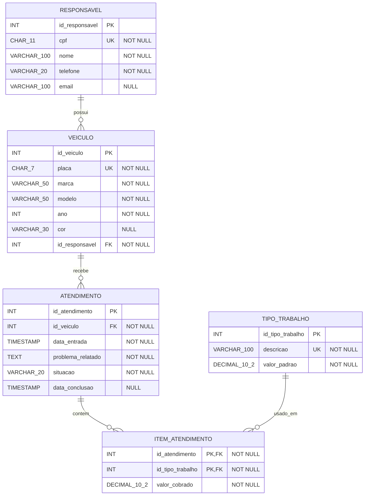

# Oficina Automotiva — Modelagem de Classes e DER

> Projeto Mobile (Flutter/Dart) · Autor: @Vittorio · 07/10/2026

## Sumário

1. [Descoberta das classes](#parte-1--descoberta-das-classes)
2. [Diagrama de classes](#parte-2--diagrama-de-classes)
3. [Relacionamentos entre as classes](#parte-3--relacionamentos-entre-as-classes)
4. [`var`, `final` e `const`](#parte-4--var-final-e-const)
5. [Métodos](#parte-5--métodos)
6. [Modelagem do banco de dados (DER)](#parte-6--modelagem-do-banco-de-dados-der)
7. [Requisitos não funcionais](#parte-7--como-o-modelo-atende-os-requisitos-não-funcionais)
8. [Como executar](#como-executar)

---

## Parte 1 — Descoberta das classes

O modelo tem **5 classes principais** e **1 enum** de apoio.

> **Dica para achar classes no texto:** procure os **substantivos que têm dados próprios e comportamento próprio** (responsável, veículo, trabalho, atendimento). Verbos viram métodos (registrar, calcular, alterar, consultar).

| Classe | O que representa no problema | Por que não é só "guardar coisas" |
|---|---|---|
| **Responsavel** | A pessoa dona/responsável pelo veículo. Pode ter vários veículos e voltar várias vezes. | Sabe quais veículos são seus e como ser contatada. |
| **Veiculo** | Um carro específico, identificado pela placa. | Tem identidade fixa (placa) e conhece seu histórico de atendimentos. |
| **TipoTrabalho** | Um serviço do catálogo da oficina (troca de óleo, alinhamento...) com valor padrão. | É reutilizado por vários atendimentos e tem regra própria: o valor pode ser reajustado. |
| **ItemTrabalho** | Um trabalho **lançado dentro de um atendimento** específico, com o valor cobrado naquele dia. | Liga `Atendimento` e `TipoTrabalho` (relação muitos-para-muitos) e congela o preço: se o valor padrão for reajustado amanhã, atendimentos antigos não mudam. |
| **Atendimento** | A ordem de serviço aberta quando o veículo entra: data, problema relatado, situação e trabalhos. | É o coração do sistema: calcula total, controla situação e impede concluir sem trabalho. |
| *SituacaoAtendimento* (enum) | Os estados possíveis: `aberto`, `emAndamento`, `aguardandoPecas`, `concluido`, `cancelado`. | Evita digitar texto livre ("concluido", "Concluído", "pronto"...) e garante consistência (RNF07). |

> **Por que `ItemTrabalho` existe?** O enunciado diz que um atendimento tem vários trabalhos e que um mesmo trabalho aparece em vários atendimentos. Isso é **muitos-para-muitos**. Além disso, o valor do tipo de trabalho pode ser reajustado, então cada atendimento precisa guardar o valor que foi cobrado na época.

---

## Parte 2 — Diagrama de classes

**Legenda:** **(F)** = `final` (atribuído uma vez, no construtor) · **(M)** = mutável · `?` = pode ser nulo · `+` = método público.

```mermaid
classDiagram
    direction LR
    class Responsavel {
        +int id (F)
        +String cpf (F)
        +String nome (M)
        +String telefone (M)
        +String? email (M)
        +List~Veiculo~ veiculos (F)
        +Responsavel(id, cpf, nome, telefone, email)
        +void adicionarVeiculo(Veiculo veiculo)
        +List~Veiculo~ listarVeiculos()
        +void atualizarContato(String telefone, String? email)
    }
    class Veiculo {
        +String placa (F)
        +String marca (F)
        +String modelo (F)
        +int ano (F)
        +String? cor (M)
        +Responsavel responsavel (M)
        +List~Atendimento~ atendimentos (F)
        +Veiculo(placa, marca, modelo, ano, responsavel, cor)
        +String identificacao()
        +List~Atendimento~ consultarHistorico()
    }
    class TipoTrabalho {
        +int id (F)
        +String descricao (F)
        +double valorPadrao (M)
        +TipoTrabalho(id, descricao, valorPadrao)
        +void reajustarValor(double novoValor)
    }
    class ItemTrabalho {
        +TipoTrabalho tipo (F)
        +double valorCobrado (F)
        +ItemTrabalho(tipo)
        +double subtotal()
    }
    class Atendimento {
        +int id (F)
        +DateTime dataEntrada (F)
        +String problemaRelatado (F)
        +Veiculo veiculo (F)
        +SituacaoAtendimento situacao (M)
        +DateTime? dataConclusao (M)
        +List~ItemTrabalho~ itens (F)
        +Atendimento(id, veiculo, problemaRelatado)
        +void adicionarTrabalho(TipoTrabalho tipo)
        +bool removerTrabalho(TipoTrabalho tipo)
        +double calcularValorTotal()
        +void alterarSituacao(SituacaoAtendimento nova)
        +bool estaEmAndamento()
        +bool podeSerConcluido()
        +String resumo()
    }
    class SituacaoAtendimento {
        <<enumeration>>
        aberto
        emAndamento
        aguardandoPecas
        concluido
        cancelado
    }
    Responsavel "1" -- "0..*" Veiculo : possui
    Veiculo "1" -- "0..*" Atendimento : recebe
    Atendimento "1" *-- "0..*" ItemTrabalho : contém
    ItemTrabalho "0..*" --> "1" TipoTrabalho : refere-se a
    Atendimento --> SituacaoAtendimento : usa
```



### Detalhe de cada classe

#### Responsavel

```dart
Responsavel({required this.id, required this.cpf, required this.nome, required this.telefone, this.email})
```

| Atributo | Tipo Dart | Final ou mutável | Por quê |
|---|---|---|---|
| `id` | `int` | final | Identificador não muda. |
| `cpf` | `String` | final | Documento da pessoa não muda. `String` porque tem zeros à esquerda e não se faz conta com ele. |
| `nome` | `String` | mutável | Pode haver correção de grafia. |
| `telefone` | `String` | mutável | Contato muda com o tempo. |
| `email` | `String?` | mutável | Opcional (nem todo cliente informa). |
| `veiculos` | `List<Veiculo>` | final | A **referência** da lista não muda, mas podemos adicionar itens nela. |

#### Veiculo

```dart
Veiculo({required this.placa, required this.marca, required this.modelo, required this.ano, required this.responsavel, this.cor})
```

| Atributo | Tipo Dart | Final ou mutável | Por quê |
|---|---|---|---|
| `placa` | `String` | final | Regra do domínio: a placa não muda durante a vida do objeto. |
| `marca`, `modelo` | `String` | final | Características de fábrica. |
| `ano` | `int` | final | Ano de fabricação não muda. |
| `cor` | `String?` | mutável | O carro pode ser repintado. |
| `responsavel` | `Responsavel` | mutável | O veículo pode ser vendido para outra pessoa. |
| `atendimentos` | `List<Atendimento>` | final | Histórico cresce, mas a lista é sempre a mesma. |

#### TipoTrabalho

```dart
TipoTrabalho({required this.id, required this.descricao, required this.valorPadrao})
```

| Atributo | Tipo Dart | Final ou mutável | Por quê |
|---|---|---|---|
| `id` | `int` | final | Identificador. |
| `descricao` | `String` | final | "Troca de óleo" continua sendo troca de óleo. |
| `valorPadrao` | `double` | mutável | Regra do domínio: o valor pode ser reajustado. |

#### ItemTrabalho

```dart
ItemTrabalho(this.tipo) : valorCobrado = tipo.valorPadrao;
```

| Atributo | Tipo Dart | Final ou mutável | Por quê |
|---|---|---|---|
| `tipo` | `TipoTrabalho` | final | Um item lançado não troca de tipo; se errou, remove e lança outro. |
| `valorCobrado` | `double` | final | Copia o valor padrão **no momento do lançamento** e congela. Reajustes futuros não alteram atendimentos antigos. |

#### Atendimento

```dart
Atendimento({required this.id, required this.veiculo, required this.problemaRelatado})
    : dataEntrada = DateTime.now(),
      situacao = SituacaoAtendimento.aberto;
```

| Atributo | Tipo Dart | Final ou mutável | Por quê |
|---|---|---|---|
| `id` | `int` | final | Identificador. |
| `dataEntrada` | `DateTime` | final | Regra do domínio: a data de abertura não muda. |
| `problemaRelatado` | `String` | final | É o relato do cliente na entrada; fica registrado como foi dito. |
| `veiculo` | `Veiculo` | final | Um atendimento não troca de carro. |
| `situacao` | `SituacaoAtendimento` | mutável | Regra do domínio: passa por vários estados. |
| `dataConclusao` | `DateTime?` | mutável | Nula até concluir; preenchida em `alterarSituacao`. |
| `itens` | `List<ItemTrabalho>` | final | A lista é fixa; os itens dentro dela entram e saem. |

> **Observação importante:** o valor total **não é atributo**. Ele é calculado pelo método `calcularValorTotal()` somando os itens. Guardar o total num atributo criaria risco de ficar desatualizado quando um trabalho é removido.

---

## Parte 3 — Relacionamentos entre as classes

Quatro das cinco classes se ligam em cadeia:

**Responsavel → Veiculo → Atendimento → ItemTrabalho → TipoTrabalho**

Como ler a cardinalidade: "um `Responsavel` tem `0..*` `Veiculos`" e "cada `Veiculo` pertence a exatamente `1` `Responsavel`".

| Relação | Cardinalidade | Tipo de situação (enunciado) | Explicação |
|---|---|---|---|
| Responsavel — Veiculo | 1 para 0..* | Um objeto pode estar relacionado a vários | Uma pessoa pode ter nenhum, um ou vários carros. Todo veículo **obrigatoriamente** tem 1 responsável (está no construtor com `required`). |
| Veiculo — Atendimento | 1 para 0..* | Um objeto obrigatoriamente depende de outro | Um carro recém-cadastrado tem 0 atendimentos e pode voltar várias vezes. Um atendimento não existe sem veículo. |
| Atendimento ◆— ItemTrabalho | 1 para 0..* (composição) | Um objeto possui outro | O atendimento é **dono** dos seus itens: se o atendimento for apagado, os itens somem junto. Para concluir, exige 1..* (regra de negócio). |
| ItemTrabalho — TipoTrabalho | 0..* para 1 | Um mesmo objeto pode ser utilizado por vários | O mesmo tipo "Alinhamento" é usado em muitos atendimentos. Cada item aponta para exatamente 1 tipo. |
| Atendimento — SituacaoAtendimento | 1 para 1 | Usa um valor de um conjunto fixo | Cada atendimento está em uma situação por vez. |

> **Composição × associação:** a ligação `Atendimento`–`ItemTrabalho` é **composição** (losango cheio) porque o item não faz sentido sozinho. Já `ItemTrabalho`–`TipoTrabalho` é só **associação**: apagar um item não apaga o tipo do catálogo.

> **Atendimento × TipoTrabalho é muitos-para-muitos** (um atendimento tem vários tipos; um tipo aparece em vários atendimentos). O `ItemTrabalho` é a classe que "quebra" essa relação em duas de um-para-muitos, e isso vira a tabela associativa no DER.

---

## Parte 4 — `var`, `final` e `const`

- **`var`**: pode receber nova atribuição; o tipo é deduzido pelo Dart.
- **`final`**: recebe valor **uma única vez**, mas esse valor pode ser descoberto só durante a execução (ex.: `DateTime.now()`).
- **`const`**: valor fixo e **conhecido já na compilação**, antes do programa rodar.

```dart
// 1. var — acumulador dentro de calcularValorTotal()
var total = 0.0;
for (final item in itens) {
  total += item.subtotal();
}

// 2. final — atributo da classe Veiculo
final String placa;

// 3. final — atributo da classe Atendimento
final DateTime dataEntrada; // recebe DateTime.now() no construtor

// 4. const — regra fixa conhecida antes da execução
static const int quantidadeMinimaTrabalhosParaConcluir = 1;

// 5. const — situação inicial de todo atendimento
static const SituacaoAtendimento situacaoInicial = SituacaoAtendimento.aberto;
```

| # | Declaração | Que informação guarda? | Pode receber nova atribuição? | Conhecido na compilação? | Por que essa escolha? |
|---|---|---|---|---|---|
| 1 | `var total = 0.0;` | Soma parcial dos subtotais enquanto percorre os itens. | **Sim**, a cada volta do laço (`total += ...`). | Não, depende dos itens do atendimento. | Precisa mudar várias vezes. O Dart deduz `double` pelo `0.0`. É variável local, vive só dentro do método. |
| 2 | `final String placa;` | A placa do veículo. | **Não**, depois do construtor. | Não, cada veículo tem a sua, digitada pelo atendente. | Regra do domínio: placa não muda. Não pode ser `const` porque cada objeto tem um valor diferente, informado em tempo de execução. |
| 3 | `final DateTime dataEntrada;` | Data e hora de abertura do atendimento. | **Não**. | Não, `DateTime.now()` só é conhecido quando o programa roda. | Regra do domínio: a data de abertura não muda. É o exemplo clássico de por que **final ≠ const**: o valor é fixo, mas só se sabe na execução. |
| 4 | `static const int quantidadeMinimaTrabalhosParaConcluir = 1;` | Mínimo de trabalhos exigido para concluir. | **Não**. | **Sim**, é o número 1, escrito no código. | O enunciado pede: "alguns valores poderão ser constantes e conhecidos antes da execução". Usado em `podeSerConcluido()`. `static` porque é da classe, não de cada atendimento. |
| 5 | `static const SituacaoAtendimento situacaoInicial = SituacaoAtendimento.aberto;` | Situação com que todo atendimento nasce. | **Não**. | **Sim**, valores de enum são constantes. | É igual para todos os atendimentos e nunca muda; o construtor faz `situacao = situacaoInicial`. |

> **Contraexemplo útil:** `situacao` (o atributo) **não** pode ser `final` nem `const`, porque a regra diz que ela necessariamente muda. Por isso é declarado só com o tipo: `SituacaoAtendimento situacao;`. O mesmo vale para `valorPadrao` em `TipoTrabalho` (`double valorPadrao;`).

> **`final List<ItemTrabalho> itens = [];` permite `itens.add(...)`?** **Sim.** O `final` trava a variável (não dá para fazer `itens = outraLista`), mas o conteúdo da lista continua alterável.

---

## Parte 5 — Métodos

Todos os 6 tipos exigidos estão cobertos, e os métodos estão espalhados por 4 classes (nenhuma classe concentra tudo — RNF06).

| Exigência | Método escolhido | Classe |
|---|---|---|
| `void` | `void alterarSituacao(SituacaoAtendimento nova)` | Atendimento |
| retorna `double` | `double calcularValorTotal()` | Atendimento |
| retorna `bool` | `bool estaEmAndamento()` | Atendimento |
| retorna `String` | `String resumo()` | Atendimento |
| recebe parâmetro | `void reajustarValor(double novoValor)` | TipoTrabalho |
| altera o estado | `void adicionarTrabalho(TipoTrabalho tipo)` | Atendimento |

### Explicação de cada método

#### 1. `void alterarSituacao(SituacaoAtendimento nova)` — Atendimento

- **Quem executa:** o próprio atendimento, quando o atendente muda o status.
- **Atributos usados:** `situacao`, `itens`, `dataConclusao`.
- **Altera ou consulta:** **altera**. Se `nova == concluido` e `podeSerConcluido()` for falso, a mudança é recusada (lança exceção). Ao concluir, preenche `dataConclusao`.
- **Por que aqui:** só o atendimento conhece sua situação e seus itens; é ele quem garante a regra "não concluir sem trabalho".

#### 2. `double calcularValorTotal()` — Atendimento

- **Quem executa:** o atendimento.
- **Atributos usados:** `itens` (chama `subtotal()` de cada `ItemTrabalho`).
- **Altera ou consulta:** **apenas calcula**.
- **Por que aqui:** o total é a soma dos trabalhos **deste** atendimento. Cada item sabe o próprio valor (`subtotal()`), e o atendimento soma — cada classe cuida da sua parte.

#### 3. `bool estaEmAndamento()` — Atendimento

- **Quem executa:** o atendimento.
- **Atributos usados:** `situacao`.
- **Altera ou consulta:** **apenas consulta**. Retorna `true` se a situação não for `concluido` nem `cancelado`.
- **Por que aqui:** a resposta depende só do estado do próprio atendimento.

#### 4. `String resumo()` — Atendimento

- **Quem executa:** o atendimento.
- **Atributos usados:** `veiculo` (via `identificacao()`), `veiculo.responsavel.nome`, `situacao` e `calcularValorTotal()`.
- **Altera ou consulta:** **apenas consulta**. Exemplo de saída:
  ```
  ABC1D23 - Gol 2015 | Resp.: João Silva | Situação: emAndamento | Total: R$ 350,00
  ```
- **Por que aqui:** o atendimento é o único objeto que "enxerga" veículo, responsável, situação e valor ao mesmo tempo.

#### 5. `void reajustarValor(double novoValor)` — TipoTrabalho

- **Quem executa:** o tipo de trabalho, quando a oficina muda a tabela de preços.
- **Atributos usados:** `valorPadrao`.
- **Altera ou consulta:** **altera** (recebe parâmetro). Rejeita valores negativos.
- **Por que aqui:** o valor padrão pertence ao catálogo, não ao atendimento. Como `ItemTrabalho.valorCobrado` é `final`, o reajuste **não** afeta atendimentos já lançados.

#### 6. `void adicionarTrabalho(TipoTrabalho tipo)` — Atendimento

- **Quem executa:** o atendimento.
- **Atributos usados:** `itens`, `situacao`.
- **Altera ou consulta:** **altera**: cria um `ItemTrabalho(tipo)` e adiciona em `itens`. Recusa se o atendimento já estiver concluído.
- **Por que aqui:** o atendimento é dono da lista de itens (composição).

### Outros métodos do modelo (apoio)

| Método | Classe | O que faz |
|---|---|---|
| `bool removerTrabalho(TipoTrabalho tipo)` | Atendimento | Remove o item **só se não estiver concluído**; retorna `true` se removeu. |
| `bool podeSerConcluido()` | Atendimento | `itens.length >= quantidadeMinimaTrabalhosParaConcluir`. |
| `double subtotal()` | ItemTrabalho | Retorna `valorCobrado`. |
| `String identificacao()` | Veiculo | Ex.: `"ABC1D23 - Gol 2015"`. |
| `List<Atendimento> consultarHistorico()` | Veiculo | Atendimentos anteriores daquele veículo (requisito funcional). |
| `void adicionarVeiculo(Veiculo v)` / `List<Veiculo> listarVeiculos()` | Responsavel | Vincula e consulta os veículos da pessoa (requisito funcional). |

---

## Parte 6 — Modelagem do banco de dados (DER)

São **5 tabelas**. A tabela `item_atendimento` é a tabela associativa que resolve o muitos-para-muitos entre atendimento e tipo de trabalho.



**Como ler os símbolos do DER:** `||` = exatamente um (obrigatório) · `o{` = zero ou muitos.
Ex.: `RESPONSAVEL ||--o{ VEICULO` = cada veículo tem 1 responsável; cada responsável tem 0..N veículos.

### Tabelas em detalhe

#### `responsavel`

| Coluna | Tipo | Chave | Obrigatório |
|---|---|---|---|
| `id_responsavel` | INT (auto incremento) | PK | Sim |
| `cpf` | CHAR(11) | UNIQUE | Sim |
| `nome` | VARCHAR(100) | — | Sim |
| `telefone` | VARCHAR(20) | — | Sim |
| `email` | VARCHAR(100) | — | Não |

#### `veiculo`

| Coluna | Tipo | Chave | Obrigatório |
|---|---|---|---|
| `id_veiculo` | INT (auto incremento) | PK | Sim |
| `placa` | CHAR(7) | UNIQUE | Sim |
| `marca` | VARCHAR(50) | — | Sim |
| `modelo` | VARCHAR(50) | — | Sim |
| `ano` | INT | — | Sim |
| `cor` | VARCHAR(30) | — | Não |
| `id_responsavel` | INT | FK → `responsavel` | Sim |

#### `tipo_trabalho`

| Coluna | Tipo | Chave | Obrigatório |
|---|---|---|---|
| `id_tipo_trabalho` | INT (auto incremento) | PK | Sim |
| `descricao` | VARCHAR(100) | UNIQUE | Sim |
| `valor_padrao` | DECIMAL(10,2) | — | Sim |

#### `atendimento`

| Coluna | Tipo | Chave | Obrigatório |
|---|---|---|---|
| `id_atendimento` | INT (auto incremento) | PK | Sim |
| `id_veiculo` | INT | FK → `veiculo` | Sim |
| `data_entrada` | TIMESTAMP | — | Sim |
| `problema_relatado` | TEXT | — | Sim |
| `situacao` | VARCHAR(20) com CHECK nos 5 valores do enum | — | Sim |
| `data_conclusao` | TIMESTAMP | — | Não |

#### `item_atendimento`

| Coluna | Tipo | Chave | Obrigatório |
|---|---|---|---|
| `id_atendimento` | INT | PK composta + FK → `atendimento` | Sim |
| `id_tipo_trabalho` | INT | PK composta + FK → `tipo_trabalho` | Sim |
| `valor_cobrado` | DECIMAL(10,2) | — | Sim |

> **Decisão de projeto — placa como PK?** Daria para usar a placa como chave primária, já que ela é única e não muda. Optamos por um `id_veiculo` numérico (chave substituta) com `placa UNIQUE`, porque chaves numéricas são menores e mais rápidas nas FKs. As duas soluções são defensáveis.

### Respostas às perguntas da Parte 6

**O que identifica unicamente cada registro?**
A chave primária: `id_responsavel`, `id_veiculo`, `id_tipo_trabalho`, `id_atendimento` e, em `item_atendimento`, a **combinação** `(id_atendimento, id_tipo_trabalho)`. Além disso, `cpf` e `placa` são únicos (UNIQUE) para impedir duplicidade no mundo real.

**Onde é necessária uma chave estrangeira?**
Sempre no lado "muitos" da relação:

- `veiculo.id_responsavel` → `responsavel`
- `atendimento.id_veiculo` → `veiculo`
- `item_atendimento.id_atendimento` → `atendimento`
- `item_atendimento.id_tipo_trabalho` → `tipo_trabalho`

**Como representar muitos-para-muitos?**
Com uma **tabela associativa** (`item_atendimento`) que tem duas FKs, uma para cada lado. Uma relação N:N vira duas relações 1:N. Ela ainda guarda um dado que só existe na combinação: o `valor_cobrado` naquele atendimento.

**Todos os atributos das classes aparecem iguais no banco?** **Não.** Diferenças principais:

- **Listas viram FKs no outro lado:** `Responsavel.veiculos` e `Veiculo.atendimentos` não são colunas; são obtidos com consulta pela FK (`WHERE id_responsavel = ?`).
- **Objetos viram ids:** `Veiculo.responsavel` (objeto) vira a coluna `id_responsavel` (número).
- **Valores calculados não são guardados:** o valor total do atendimento não tem coluna; é `SUM(valor_cobrado)`.
- **Tipos mudam:** `double` vira `DECIMAL(10,2)` (dinheiro exato no banco); o enum vira `VARCHAR` com CHECK; `DateTime` vira `TIMESTAMP`.
- **`final` e `const` não existem no banco:** a regra "placa não muda" é garantida pela aplicação; o `const` de quantidade mínima é regra de código, não coluna.

---

## Parte 7 — Como o modelo atende os requisitos não funcionais

Cada RNF tem pelo menos uma decisão concreta no modelo que o sustenta.

| RNF | Como o modelo atende |
|---|---|
| **RNF01 — Usabilidade** | Situação como enum (o funcionário escolhe numa lista, não digita); `resumo()` mostra tudo em uma linha; valor do trabalho já vem preenchido pelo `valorPadrao`. |
| **RNF02 — Desempenho** | Chaves numéricas e FKs indexáveis; `placa` e `cpf` com UNIQUE (índice) deixam a busca por veículo/cliente rápida, dentro dos 2 segundos. |
| **RNF03 — Persistência** | Todas as classes têm tabela correspondente no banco; nada importante fica só em memória. |
| **RNF04 — Integridade** | FKs `NOT NULL` impedem veículo sem responsável e atendimento sem veículo; CHECK na situação; PK composta impede o mesmo trabalho duplicado no atendimento; regra "não concluir sem trabalho" em `alterarSituacao`. |
| **RNF05 — Portabilidade** | Modelo pensado para Dart/Flutter (tipos `String`, `int`, `double`, `bool`, `DateTime`), que roda em Android e iOS com o mesmo código. |
| **RNF06 — Manutenibilidade** | Responsabilidades divididas: `TipoTrabalho` cuida do preço, `ItemTrabalho` do subtotal, `Atendimento` do total e da situação, `Veiculo` do histórico, `Responsavel` dos seus veículos. |
| **RNF07 — Consistência** | Dinheiro sempre `double` no Dart e `DECIMAL(10,2)` no banco; datas sempre `DateTime` / `TIMESTAMP`; ids sempre `int`; situação sempre pelo mesmo enum. |

> **Ponto de atenção (RNF07):** `double` pode ter pequenos erros de arredondamento (`0,1 + 0,2 ≠ 0,3` exato). No banco usamos `DECIMAL`, que é exato. Uma evolução seria guardar centavos como `int` no Dart (ex.: R$ 89,90 = `8990`). Mantivemos `double` porque o enunciado pede um método que retorne `double`.

---

## Como executar

Pré-requisito: [Flutter SDK](https://docs.flutter.dev/get-started/install) instalado.

```bash
flutter pub get
flutter run
```
